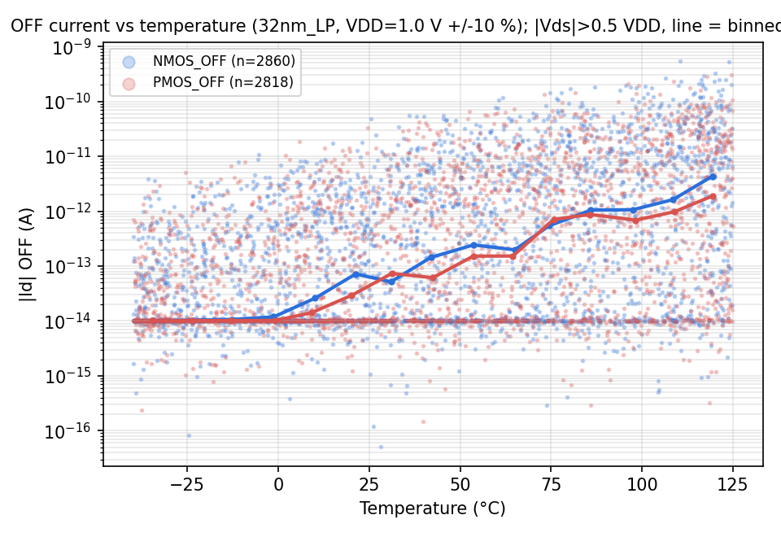
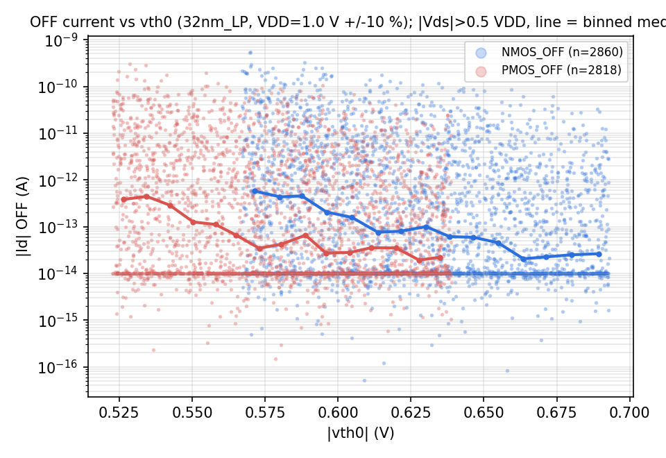
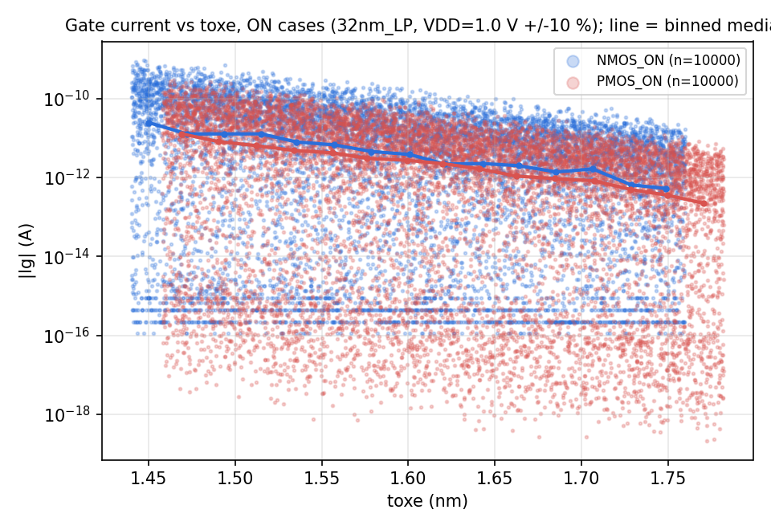
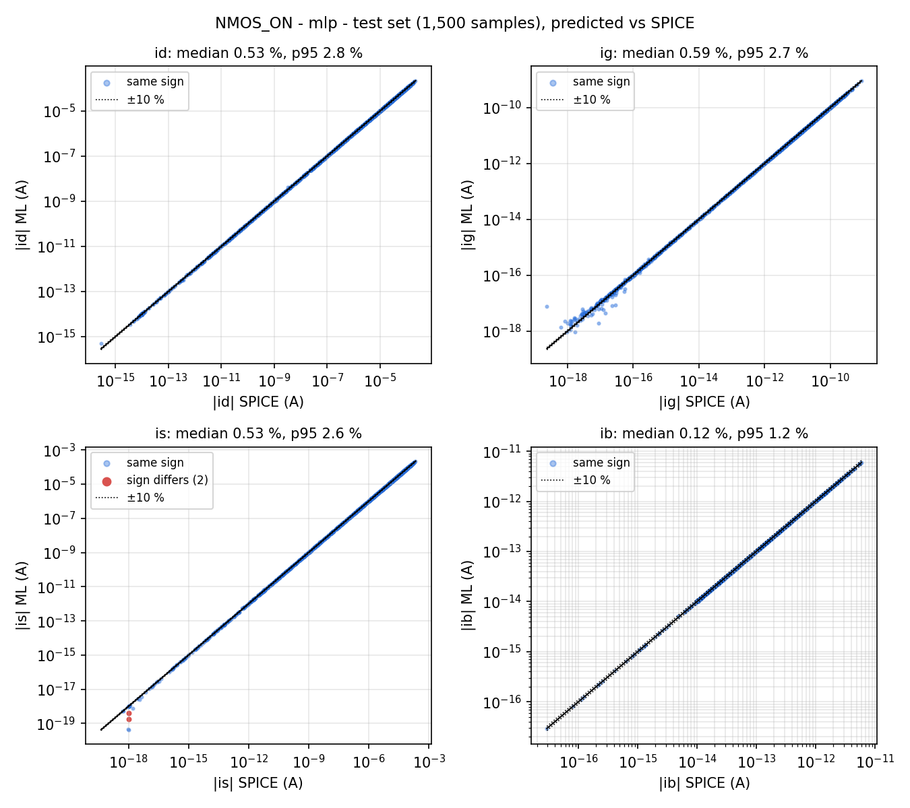
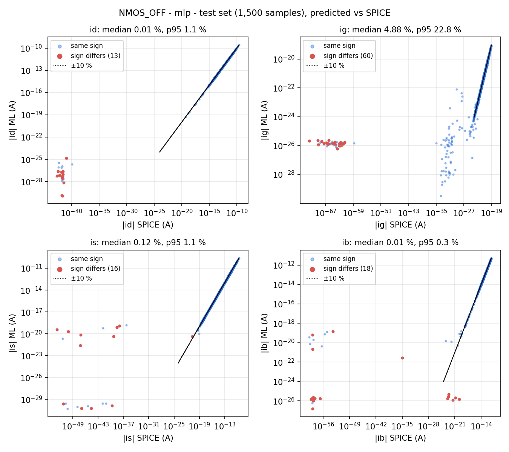
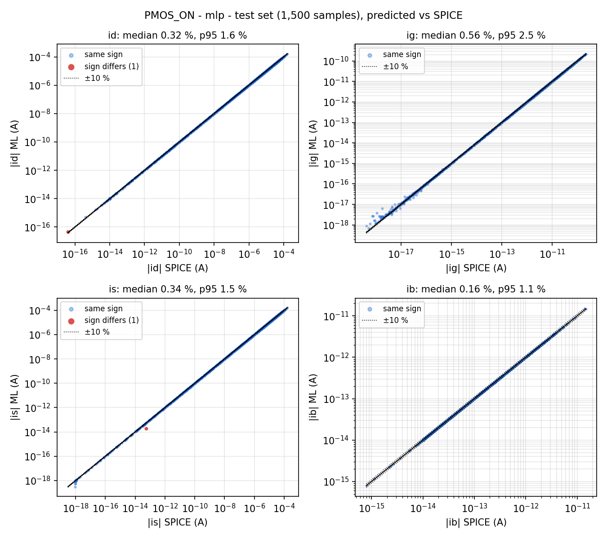
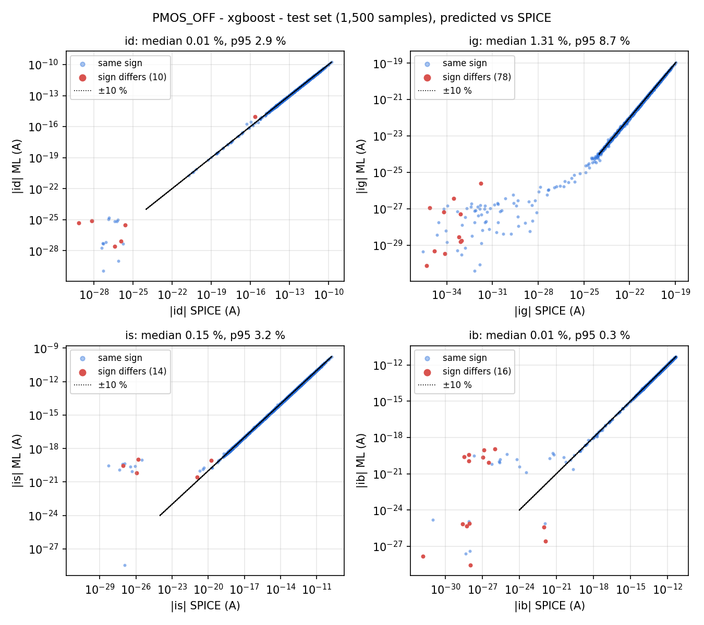
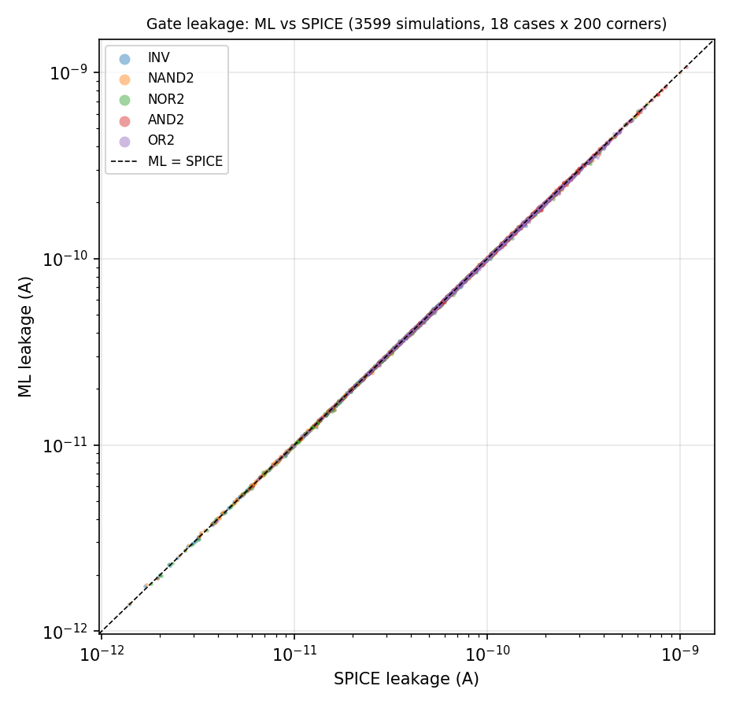
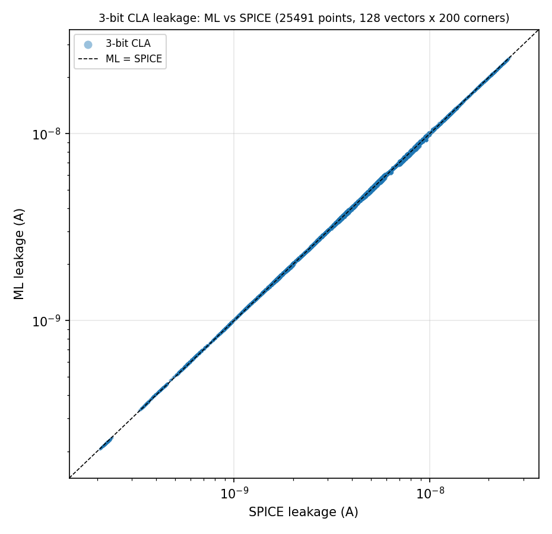

# ML-Driven PVT Variation Aware Leakage Estimation

Digital VLSI Design course project report

## 1. Setup

| Item | Value |
|---|---|
| Model file | PTM 32 nm LP (`models/32nm_LP.pm`, BSIM4) |
| Nominal VDD | 1.0 V (sampled within ±10 %) |
| Channel length | 32 nm; widths 1 to 8 × Lmin (32 to 256 nm) |
| Test circuit | 3-bit carry-lookahead adder (CLA) |
| Simulator | ngspice-44.2 (Windows, batch mode), DC operating-point analysis |
| Software | Python 3.10, scikit-learn, XGBoost |
| Netlist options | `.options gmin=1e-18 abstol=1e-18 reltol=1e-6 vntol=1e-9` in every netlist |

**Summary of results**

| Part | What is compared | Points | Median error | 95th-pct error | Mean accuracy |
|---|---|---|---|---|---|
| A | Transistor Id, Ig, Is, Ib in the ON cases (test set) | 1,500 per case | 0.12–0.59 % | 1.1–2.8 % | 99.1–99.7 % |
| B | Leakage of INV, NAND2, NOR2, AND2, OR2 | 3,599 | 0.69 % | 2.07 % | 99.17 % |
| C | Leakage of the 3-bit CLA | 25,491 | 0.73 % | 1.79 % | 99.20 % |

## 2. Data generation

### 2.1 Sampling

For each of the four cases (NMOS ON, NMOS OFF, PMOS ON, PMOS OFF), 10,000 samples are drawn with
a fixed seed per case. VDD is drawn first. The gate and body voltages are fixed by the case.

| Parameter | Distribution |
|---|---|
| VDD | uniform, 0.9 to 1.1 V |
| Vd, Vs | uniform, 0 to VDD (see the two additions below) |
| W | uniform, 32 to 256 nm |
| Temperature | uniform, −40 to 125 °C (see below) |
| vth0, toxe, ndep, u0, xj | uniform, model-card value ±10 %, separate values for NMOS and PMOS |

Two additions to plain uniform sampling:

1. **Mild corner enrichment.** With probability 4 % the temperature is drawn within 10 °C of one
   end of its range, and with probability 6 % Vd (or Vs) is drawn within 5 % of VDD of a rail. This
   raises the share of samples at the temperature extremes from 12.1 % to about 15.7 %.
2. **Gate operating points (20 % of the samples).** Inside a logic gate a transistor is never at
   a random (Vd, Vs). OFF transistors sit exactly on the rails, ON transistors have Vd within
   nanovolts to microvolts of Vs, and stack nodes sit a few millivolts from a rail. For 20 % of the
   samples, (Vd, Vs) is drawn from such points: one terminal at 0 V, at VDD or uniform; the other
   exactly on a rail, within a step δ of the first terminal, within δ of a rail, or uniform, with δ
   log-uniform from 1e-8 V to 0.3 V. All other parameters of these samples are drawn as usual.

The second addition was needed for Part B. Models trained without it reached about 1 % error on
their own test set but 20–60 % error inside gates, because the gate operating points lie on the
edge of the sampled region where almost no training samples fall.

### 2.2 Netlists

Each sample is one single-transistor netlist in which every terminal has its own voltage source.
The five process parameters are `.param` variables in a parametrised copy of the model card
(`32nm_LP_param.lib`), and the temperature is set with `.temp`. Terminal currents are taken as
the current into the device, −I(V source). Many netlists are run in one ngspice process, and 12
processes run in parallel; 40,000 samples take about 3 minutes. All 40,000 converged.

Alongside the four terminal currents, the script saves the internal BSIM4 current components of
every sample (channel current, junction currents, gate tunnelling parts, GIDL, impact ionisation).
These are used only as training targets.

### 2.3 Split

Each dataset is split at random into 7,000 training, 1,500 validation and 1,500 test samples
(seed 42).

### 2.4 Data check

**Kirchhoff check** (Id + Ig + Is + Ib):

| Case | Largest residual (A) | Median residual (A) | Median largest terminal current (A) |
|---|---|---|---|
| NMOS ON | 2.3e-15 | 1.3e-16 | 2.6e-06 |
| NMOS OFF | 4.8e-22 | 3.5e-26 | 1.7e-14 |
| PMOS ON | 5.5e-16 | 3.3e-17 | 1.6e-06 |
| PMOS OFF | 1.0e-15 | 3.7e-17 | 1.4e-14 |

The residuals are at the rounding level of the simulator (about 1e-16 A), far below the currents.

**Trend plots:**





The OFF current rises steeply with temperature and falls with vth0 (subthreshold conduction), and
the gate current falls steeply as toxe increases (direct tunnelling), as expected.

## 3. Models

### 3.1 Preprocessing: physics-based component models

A terminal current is a sum of mechanisms with very different behaviour, so the models don't learn
Id, Ig, Is and Ib directly. Each mechanism gets a physics equation whose coefficients are fitted on
the training set, and the ML model learns only the correction ln(I_SPICE + ε) − ln(I_physics + ε).

| Mechanism | Physics equation | ML correction |
|---|---|---|
| Channel current, ON | EKV equation with Vth including body effect, DIBL, temperature and process | yes |
| Channel current, OFF | subthreshold equation I0·(W/L)·exp((Vgs−Vth)/nVt)·(1−exp(−Vds/Vt)) | yes |
| Source junction | reverse diode with the BSIM4 temperature law | yes |
| Gate-body tunnelling | direct-tunnelling form in W, toxe, Vgb, T | yes |
| Gate-channel tunnelling (source and drain side) | same form with Vgs and Vgd | yes |
| Impact ionisation | function of channel current and Vds | yes |
| Drain junction | diode with 1e-14 A saturation current (exact) | no |
| GIDL / GISL | BSIM4 GIDL equation with the model-card constants (exact) | no |

The four terminal currents are assembled from the mechanisms with Kirchhoff's law, so they always
sum to zero. Other preprocessing:

* **Inputs:** 25 features (voltages relative to source and body, temperature terms, normalised
  process parameters) plus the six physics-equation values, 31 inputs in total.
* **Soft floor ε:** 1e-5 of each mechanism's 90th-percentile magnitude. Currents far below it are
  negligible, and the floor stops them from dominating the fit.
* **Input limits:** each input is limited to its training range, so a transistor exactly on a rail
  can't push the correction outside what was learned.

### 3.2 Model types

| Model | Main hyperparameters |
|---|---|
| Polynomial ridge | all degree-3 terms of the 31 standardised inputs, ridge α = 1e-3 |
| Random forest | 300 trees, max_features 0.5 |
| XGBoost | learning rate 0.03, depth 6, subsample and colsample 0.8, early stopping on 10 % of the training set |
| MLP neural network | 3 hidden layers of 128 (tanh), Adam, learning rate 1e-3, batch 64, early stopping on 10 % of the training set |

### 3.3 Model comparison (validation set)

Error = |I_ML − I_SPICE| / max(|I_SPICE|, 1 fA). For the OFF-state gate current (about 1e-22 A) the
floor is a tenth of its median. R² is computed on asinh(I / floor). Each cell is
R² / median error % / 95th-percentile error %.

| Case | Model | Id | Ig | Is | Ib | Score |
|---|---|---|---|---|---|---|
| NMOS ON | Polynomial ridge | 1.0000 / 0.40 / 2.05 | 1.0000 / 1.06 / 5.71 | 1.0000 / 0.44 / 2.07 | 0.9999 / 0.35 / 2.15 | 1.78 |
| | Random forest | 1.0000 / 2.43 / 11.32 | 0.9996 / 4.78 / 19.49 | 1.0000 / 2.44 / 10.98 | 0.9996 / 0.29 / 8.32 | 7.50 |
| | XGBoost | 1.0000 / 1.17 / 5.56 | 0.9999 / 2.22 / 9.91 | 1.0000 / 1.17 / 5.61 | 0.9999 / 0.23 / 4.65 | 3.81 |
| | **MLP** | 1.0000 / 0.53 / 2.51 | 1.0000 / 0.57 / 2.45 | 1.0000 / 0.53 / 2.38 | 1.0000 / 0.12 / 1.12 | **1.28** |
| NMOS OFF | Polynomial ridge | 1.0000 / 0.01 / 1.36 | 0.9912 / 3.68 / 33.07 | 1.0000 / 0.25 / 2.01 | 1.0000 / 0.02 / 1.64 | 5.25 |
| | Random forest | 0.9999 / 0.02 / 7.02 | 0.9894 / 11.31 / 49.46 | 0.9999 / 0.15 / 6.65 | 1.0000 / 0.01 / 0.21 | 9.35 |
| | XGBoost | 1.0000 / 0.01 / 3.22 | 0.9975 / 4.85 / 26.18 | 1.0000 / 0.14 / 3.22 | 1.0000 / 0.01 / 0.22 | 4.73 |
| | **MLP** | 1.0000 / 0.01 / 1.27 | 0.9968 / 4.63 / 22.95 | 1.0000 / 0.13 / 1.26 | 1.0000 / 0.01 / 0.33 | **3.82** |
| PMOS ON | Polynomial ridge | 1.0000 / 0.27 / 1.42 | 1.0000 / 0.79 / 5.27 | 1.0000 / 0.31 / 1.68 | 1.0000 / 0.25 / 1.78 | 1.47 |
| | Random forest | 1.0000 / 2.03 / 8.59 | 0.9997 / 3.69 / 15.26 | 0.9997 / 2.03 / 8.62 | 0.9997 / 0.26 / 7.93 | 6.05 |
| | XGBoost | 1.0000 / 0.97 / 4.67 | 0.9999 / 1.82 / 7.92 | 1.0000 / 0.96 / 4.84 | 0.9999 / 0.15 / 3.67 | 3.13 |
| | **MLP** | 1.0000 / 0.32 / 1.51 | 1.0000 / 0.60 / 2.55 | 1.0000 / 0.33 / 1.64 | 1.0000 / 0.14 / 1.08 | **1.02** |
| PMOS OFF | Polynomial ridge | 1.0000 / 0.01 / 1.18 | 0.8856 / 3.95 / 37.47 | 1.0000 / 0.22 / 1.93 | 1.0000 / 0.02 / 1.61 | 5.80 |
| | Random forest | 0.9999 / 0.01 / 6.37 | 0.9989 / 3.59 / 15.78 | 0.9989 / 0.15 / 6.11 | 1.0000 / 0.01 / 0.30 | 4.04 |
| | **XGBoost** | 1.0000 / 0.01 / 2.76 | 0.9997 / 1.26 / 8.51 | 0.9999 / 0.13 / 2.87 | 1.0000 / 0.01 / 0.27 | **1.98** |
| | MLP | 1.0000 / 0.01 / 0.98 | 0.9991 / 3.69 / 12.38 | 1.0000 / 0.09 / 0.97 | 1.0000 / 0.01 / 0.31 | 2.30 |

**Choice.** The score is the mean over the four currents of (median + 95th percentile) / 2, and the
model with the lowest validation score is chosen for each case: the MLP for NMOS ON, NMOS OFF and
PMOS ON, and XGBoost for PMOS OFF. The MLP gives the smoothest corrections, which suits the smooth
physics. XGBoost wins PMOS OFF because of the gate current there. The physics equations alone
score 39 to 54 on the ON cases, so both the physics and the ML correction are needed.

### 3.4 Chosen models on the test set

Median / 95th-percentile error (%):

| Case | Id | Ig | Is | Ib |
|---|---|---|---|---|
| NMOS ON (MLP) | 0.53 / 2.77 | 0.59 / 2.68 | 0.53 / 2.59 | 0.12 / 1.19 |
| NMOS OFF (MLP) | 0.01 / 1.12 | 4.88 / 22.80 | 0.12 / 1.11 | 0.01 / 0.34 |
| PMOS ON (MLP) | 0.32 / 1.56 | 0.56 / 2.49 | 0.34 / 1.55 | 0.16 / 1.15 |
| PMOS OFF (XGBoost) | 0.01 / 2.90 | 1.31 / 8.75 | 0.15 / 3.18 | 0.01 / 0.28 |






The four saved models are `ml_models/<CASE>.joblib`.

## 4. Gate results (Part B)

### 4.1 Method

* **Gates:** static CMOS INV, NAND2 and NOR2; AND2 and OR2 are a NAND2 or NOR2 followed by an INV
  and are simulated as complete gates. Widths (NMOS / PMOS, in Lmin): INV 2 / 4, NAND2 4 / 4,
  NOR2 2 / 8. Input order is AB; in the NAND2, A drives the NMOS next to the output, and in the
  NOR2, A drives the PMOS next to VDD.
* **Corners:** 200 random draws of VDD, temperature and the ten process parameters (seed 2025).
  All NMOS in a gate share one process draw and all PMOS another.
* **Leakage:** the current drawn from every source at VDD (the supply and the inputs that are
  high), which equals the static power divided by VDD.
* **ML prediction:** the internal node and output voltages recorded from SPICE give the terminal
  voltages of each transistor. The ON or OFF model of Part A predicts its terminal currents, and
  the gate leakage is Σ (Vd·Id + Vg·Ig + Vs·Is + Vb·Ib) / VDD over the transistors.
* **Internal node voltages from ML:** also recorded, by solving Kirchhoff's current law at each
  internal node with the transistor models. They agree with SPICE to a few microvolts, and the
  leakage computed from them has the same accuracy.

### 4.2 Gate results table

| Gate | Input | SPICE median (A) | ML median (A) | Bias % | Median error % | p95 error % |
|---|---|---|---|---|---|---|
| INV | 0 | 2.137e-11 | 2.133e-11 | 0.53 | 0.78 | 2.30 |
| INV | 1 | 4.278e-11 | 4.257e-11 | 0.26 | 0.68 | 2.60 |
| NAND2 | 00 | 2.522e-11 | 2.495e-11 | 0.56 | 0.78 | 2.52 |
| NAND2 | 01 | 9.406e-11 | 9.390e-11 | 0.67 | 0.74 | 1.77 |
| NAND2 | 10 | 2.432e-11 | 2.433e-11 | 0.30 | 0.60 | 2.19 |
| NAND2 | 11 | 1.330e-10 | 1.331e-10 | 0.66 | 0.87 | 2.54 |
| NOR2 | 00 | 7.204e-11 | 7.135e-11 | 0.40 | 0.73 | 2.29 |
| NOR2 | 01 | 9.522e-11 | 9.527e-11 | 0.16 | 0.70 | 2.25 |
| NOR2 | 10 | 4.314e-11 | 4.301e-11 | 0.55 | 0.69 | 1.78 |
| NOR2 | 11 | 4.456e-11 | 4.446e-11 | 0.45 | 0.65 | 1.64 |
| AND2 | 00 | 8.342e-11 | 8.391e-11 | 0.43 | 0.72 | 1.91 |
| AND2 | 01 | 1.405e-10 | 1.403e-10 | 0.51 | 0.67 | 1.73 |
| AND2 | 10 | 7.142e-11 | 7.199e-11 | 0.36 | 0.64 | 1.93 |
| AND2 | 11 | 1.718e-10 | 1.733e-10 | 0.66 | 0.82 | 2.05 |
| OR2 | 00 | 1.257e-10 | 1.261e-10 | 0.33 | 0.65 | 1.86 |
| OR2 | 01 | 1.162e-10 | 1.164e-10 | 0.14 | 0.69 | 2.01 |
| OR2 | 10 | 6.903e-11 | 6.955e-11 | 0.54 | 0.60 | 1.42 |
| OR2 | 11 | 8.478e-11 | 8.464e-11 | 0.47 | 0.59 | 1.53 |
| All | | 6.964e-11 | 6.987e-11 | 0.46 | 0.69 | 2.07 |

Bias is the median of (ML − SPICE) / SPICE. The mean error over all 3,599 simulations is 0.83 %,
a mean accuracy of 99.17 %. One of the 3,600 SPICE simulations gave no usable solution and is left
out.



### 4.3 Comment

All 18 cases are close: the median error is between 0.59 % and 0.87 %. The most accurate cases are
OR2 with inputs 11 and 10 and NAND2 with input 10 (0.59–0.60 %). The least accurate are NAND2 with
input 11 (0.87 %), AND2 with input 11 (0.82 %), and INV with input 0 and NAND2 with input 00
(0.78 %). The cases with all inputs high are the ones where the ON NMOS gate tunnelling current is
largest, and that current is the least accurate of the ON-state predictions. The bias is small and
positive everywhere (0.14 % to 0.67 %).

## 5. Test-circuit results (Part C)

### 5.1 Circuit

The 3-bit CLA uses only the Part B gates. With g_i = a_i·b_i and p_i = a_i ⊕ b_i:

* c1 = g0 + p0·c0
* c2 = g1 + p1·g0 + p1·p0·c0
* c3 = g2 + p2·g1 + p2·p1·g0 + p2·p1·p0·c0
* s_i = p_i ⊕ c_i

Each XOR is four NAND2. The circuit has 42 gates (24 NAND2, 12 AND2, 6 OR2) and 204 transistors,
with 7 inputs (a0–a2, b0–b2, c0), so 128 input vectors.

### 5.2 Method

* **SPICE:** the complete transistor netlist, all 128 input vectors at the same 200 corners:
  25,600 operating points, of which one did not converge. The sum and carry outputs are logically
  correct in every simulation.
* **ML:** for each input vector a logic simulation gives the inputs of every gate. The Part B gate
  model is evaluated for each of the 42 gates at that corner, and the gate leakages are summed.

### 5.3 Results

| | SPICE median (A) | ML median (A) | Bias % | Median error % | p95 error % | Mean error % |
|---|---|---|---|---|---|---|
| All 25,491 points | 4.517e-09 | 4.532e-09 | 0.60 | 0.73 | 1.79 | 0.80 |
| Most accurate vector (A=001 B=100 Cin=1) | 4.630e-09 | 4.660e-09 | 0.59 | 0.69 | 1.75 | 0.79 |
| Least accurate vector (A=001 B=110 Cin=1) | 4.939e-09 | 4.951e-09 | 0.59 | 0.77 | 1.88 | 0.83 |

The mean accuracy is 99.20 %. The circuit leakage ranges from 2.1e-10 A to 2.6e-08 A over the
corners. The table for all 128 input vectors is `results/tables/circuit_results_table.csv`.



### 5.4 Comparison with the gate level

| | Median error % | p95 error % | Mean error % | Bias % |
|---|---|---|---|---|
| Gates (Part B) | 0.69 | 2.07 | 0.83 | 0.46 |
| 3-bit CLA (Part C) | 0.73 | 1.79 | 0.80 | 0.60 |

The circuit accuracy is the same as the gate accuracy; it is not lower, as the spec anticipates.
Two reasons:

* **Composition costs almost nothing here.** Adding the SPICE leakages of the 42 standalone gates
  reproduces the SPICE leakage of the whole circuit to 0.002 % (median) and 0.012 % (95th
  percentile). Internal nodes sit within microvolts of the rails, and counting the current into
  high inputs as part of each gate's leakage makes the gate leakages add up exactly.
* **Errors neither grow nor average out.** All 42 gates share the same corner, so the same
  transistor-model error appears in every gate and carries through to the sum. The spread across
  input vectors is small (0.69–0.77 %), and the 95th percentile is slightly lower than for single
  gates because the sum mixes several gate types.

## 6. Error analysis

* **Transistor level.** The largest relative errors are in the OFF-state gate current (median
  4.9 % for NMOS, 1.3 % for PMOS). That current is about 1e-22 A and has no effect on leakage.
  Among currents that matter, the ON-state gate tunnelling current is the hardest (0.6 % median,
  2.5–2.7 % at the 95th percentile): it depends exponentially on toxe and on both Vgs and Vgd.
* **What sets the gate accuracy.** In this low-power technology most of the gate leakage is gate
  tunnelling through the ON transistors. For the INV at one corner (VDD 1.10 V, 30 °C), the ON
  PMOS tunnelling current is 3.7e-11 A and the OFF NMOS subthreshold current is 5.3e-12 A. So the
  gate error follows the ON-state Ig error.
* **By corner.** At the gate level the median error is 0.81 % below 0 °C, 0.76 % from 0 to 60 °C
  and 0.54 % above 60 °C; the 95th percentile is highest below 0 °C (2.7 %). By supply voltage,
  the 95th percentile is highest for VDD above 1.03 V (2.5 %, against 1.8–1.9 % lower down). The
  ten largest single gate errors (4.5–5.9 %) are at hot, high-VDD corners (corner 74: 113 °C,
  1.098 V) and at one cold corner (corner 40: −17.5 °C) where the leakage is only a few pA.
* **By gate and input.** Cases with all inputs high (NAND2 11, AND2 11) are slightly worse, as in
  section 4.3. In the circuit, the largest errors (about 4 %) are again all at corner 74.
* **Why the gate operating points matter.** Before they were added to the training data, the same
  models gave a 26–46 % mean gate error with a steady negative bias, although their test-set
  errors were about 1 %. The ON transistors in a gate have Vd ≈ Vs and a full Vgs, which is the
  corner of the sampled (Vd, Vs) square, and the ML corrections were extrapolating there.
* **SPICE reference.** A few gate simulations converged to a non-physical solution (an internal
  node above VDD) with a leakage about 100 times too high. Solutions with any node outside
  [0, VDD] are rerun with a different starting guess; 4 simulations needed this.

## 7. Limitations and improvements

* **A systematic bias remains** (+0.5 % at the gates, +0.6 % in the circuit). Because every gate
  in a circuit shares the corner, this bias doesn't average out. More samples at gate operating
  points, or a better tunnelling equation with the BSIM4 Igc partition between source and drain,
  should reduce it.
* **The training data is tuned to gates.** 20 % of the samples are gate operating points, so the
  dataset is no longer purely uniform. The models are most accurate where gates operate and less
  so in parts of the (Vd, Vs) range that gates don't use.
* **The models need BSIM4's internal current components for training.** These come free from the
  same simulations, but a different simulator or model card may not expose them.
* **Drain and source junction areas are left at their defaults** (as in the TA's example netlist),
  which gives the drain junction a fixed 1e-14 A saturation current. With real layout areas the
  junction leakage would change and the models would need retraining.
* **Part B uses node voltages from SPICE,** as the spec asks. The models can also solve the
  internal nodes themselves (section 4.1) with no loss of accuracy, so a SPICE-free flow is
  possible; this was verified only for the five gates here.
* **The circuit method assumes rail-to-rail gate inputs.** That holds for this static CMOS adder
  (the composition error is 0.002 %), but not for circuits with pass transistors or degraded
  logic levels.
* **Only DC leakage at fixed input vectors is covered.** Larger circuits would need the input
  vectors sampled instead of enumerated.

## 8. Reproducing the results

```
python scripts/01_generate_transistor_data.py   # Part A step 1 (~3 min)
python scripts/02_check_transistor_data.py      # Kirchhoff check and trend plots
python scripts/03_train_transistor_models.py    # Part A step 2 (~25 min)
python scripts/04_gate_validation.py            # Part B (~6 min)
python scripts/05_circuit_validation.py         # Part C (~35 min)
```

All random draws use fixed seeds set in `scripts/config.py`.
